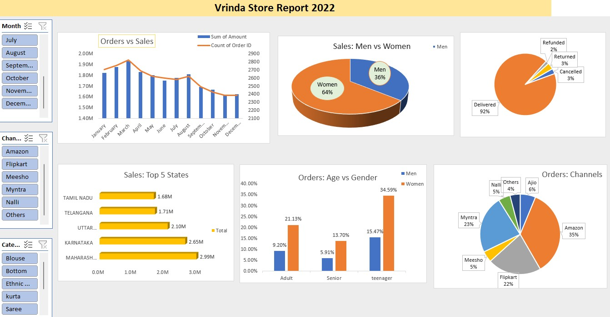

# Excel--Sales--Dashboard
Excel sales dashboard using Pivot Tables, Slicers, and Charts
## Dashboard Preview
` click here for Dashboard `(Vrinda Store Data Analysis)

# Vrinda Store Sales Dashboard 📊

## Project Overview
I developed an interactive sales dashboard using Microsoft Excel to analyze sales performance and customer purchasing behavior. I cleaned the raw data and used Pivot Tables, Pivot Charts, and Slicers to build the dashboard.

## Tools and Skills Used
- Microsoft Excel
- Data Cleaning
- Pivot Tables and Pivot Charts
- Slicers
- Data Visualization

## Key Areas Covered
- **Orders vs. Sales Comparison:** Compared order volume and sales performance.
- **Order Channel Analysis:** Analyzed which channels customers use to place orders.
- **Gender Analysis:** Examined the customer gender distribution.
- **Age Group Analysis:** Analyzed customer distribution across different age groups.
- **Interactive Dashboard:** Used slicers to filter and explore the data.

## Project Objectives
To transform raw sales data into meaningful visual insights and make sales performance and customer behavior easier to understand.

## Key Learnings
- Cleaning and preparing data.
- Creating Pivot Tables and Pivot Charts.
- Building interactive dashboards using slicers.
- Presenting data through charts and visualizations.

Aspiring Data Analyst | Excel | SQL | Python | Power BI
